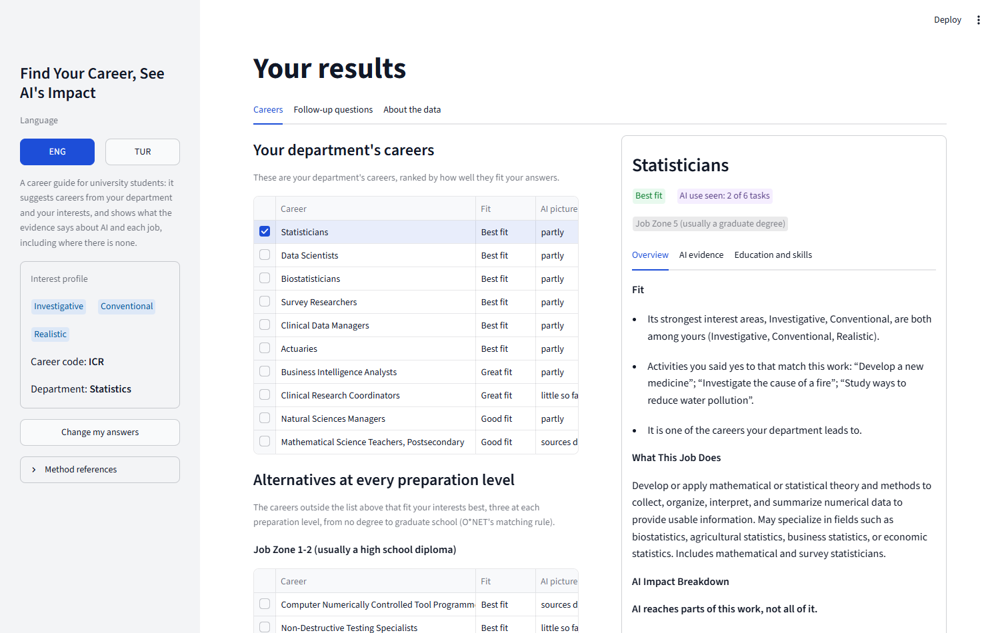
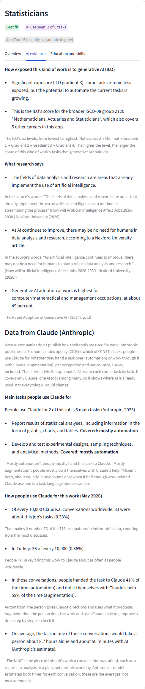
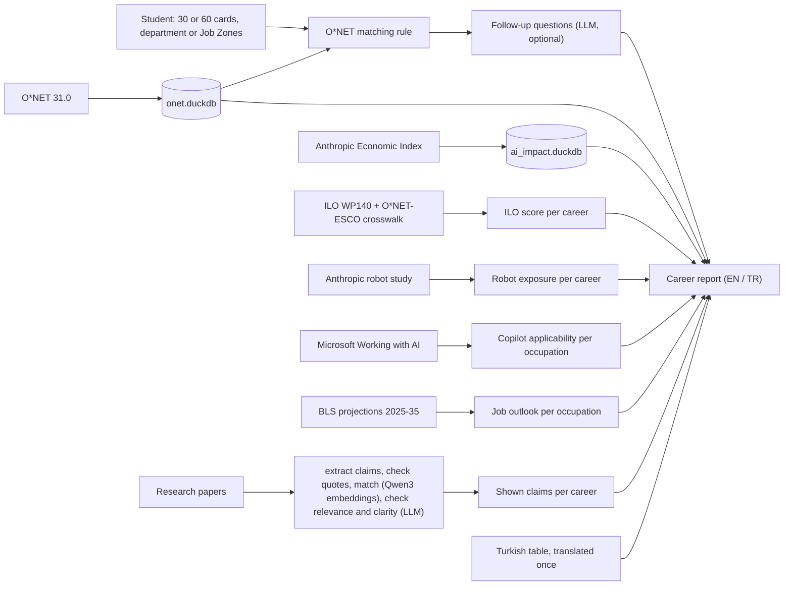

# Find Your Career, See AI's Impact

A career test for university students, in Turkish and English: it suggests careers from your interests and shows, for each one, what the evidence says about AI and that job, including where there is no evidence.

<p>
  
</p>

*The results for a test profile (Investigative, Conventional, Realistic; Statistics department): the department's careers ranked by O\*NET's fit, the alternatives at every preparation level below them, and the selected career on the right.*

<details>
<summary>A career's AI evidence tab</summary>
<p>
  
</p>
<em>Each source in its own section, never merged: the US job outlook (BLS), the ILO's rating, the robot study, research findings with their quotes, Microsoft's Copilot data, then the data from Claude (Anthropic), each figure explained where it is shown.</em>
</details>

Python 3.13 · Streamlit · DuckDB · O\*NET 31.0 · 98 tests · evaluation notebooks in [`notebooks/`](notebooks/)

## What it does

1. **The test.** 30 yes/no activity cards (O\*NET's Mini Interest Profiler; the 60-card short form is an option) give six interest scores. The student then picks their **department** (96 Turkish university departments). If it isn't listed, they pick a preparation level instead (O\*NET's Job Zones).
2. **The matches.** A department's careers come from the US fields of study it corresponds to, through NCES's official field-of-study → occupation crosswalk, reviewed by hand. They are ranked by **O\*NET's own matching rule** (Pearson r between the student's scores and each occupation's, "Best fit" r ≥ .729); without a department, the rule runs over every occupation in both Job Zones. Optional follow-up questions, interpreted by an LLM, refine the order.
3. **The report,** a desktop layout: the careers on the left, the selected one on the right. Each career shows what the job does, its most important tasks, skills and education, and **AI evidence from independent sources side by side, never merged into one score**:
   - **The US job outlook (BLS):** the projected change in US employment, 2025 to 2035, against all jobs, with BLS's own reasons, which for some jobs name AI.
   - **Anthropic task coverage:** which of the job's tasks people actually do with Claude (observed use, Aug and Nov 2025), and how much Claude is used for the job worldwide and in Turkey.
   - **The ILO's exposure index:** how exposed the job's broader occupation group is to generative AI, assessed by experts and a model.
   - **Anthropic's robot study:** how much of the job's working time goes to physical tasks robots have been shown doing, and in what setting (a robot cell, a structured workplace, anywhere), each task with a cited robot.
   - **Microsoft's Copilot data:** how much of the job's work people brought to Bing Copilot (US, 2024), how often it completed what was asked, and the job's most important activities among them.
   - **Research findings:** up to 3 claims from papers and reports about this career, each with its **verbatim quote**, page and source.
4. **Alternatives at every preparation level:** the best fits outside the list by the same O\*NET rule, three each from no degree to graduate school, so a student whose department doesn't fit their interests sees what does.
5. **New job titles** (prompt engineer, data annotator, MLOps engineer…), which O\*NET has no occupation for, appear under their closest O\*NET careers, with a note that they are not the same job.

Real output, from the test profile `investigative_conventional` ([`baseline/`](baseline/)): its first matches for Job Zone 3 are *Computer Systems Engineers/Architects, Web Developers, Forensic Science Technicians, Chemical Technicians, Quality Control Analysts*, all "Best fit".

## Why it exists

Students choosing a career ask "will AI take this job?" The usual answers are a single risk score with unclear meaning, or nothing. This project asks a narrower question: **can AI-impact evidence be attached to individual careers honestly, and how much of it exists?**

The second half has a clear answer in the data. Of the 18,681 O\*NET tasks with an Anthropic value, **90.8% are not covered**, and **442 of 923 careers (48%) have no covered task at all**. 127 careers have no AI evidence in any source. So the most common thing the app says is "not observed", and it says what that means: no Claude use was seen, which is **not** the same as "safe from AI". Coverage follows preparation and kind of work: office, computer and teaching tasks are covered; construction, production and repair almost never are ([notebook 54](notebooks/54_ai_coverage.ipynb)).

## From RAG to retrieve-and-verify

This started as a retrieval-augmented generation (RAG) system in an applied NLP course (MTH227). O\*NET data and AI-impact evidence were split into chunks and embedded into Chroma vector indexes, and an LLM wrote a cited career report from what the search returned. When I rebuilt it, I removed the generation step and most of the vector search on purpose:

- **In career advice, a wrong sentence is worse than none.** An LLM writing from retrieved text can add a detail no source contains, and a student can't tell. So nothing the app says about AI and a career is written when the report is made. Each research finding appears with its verbatim quote, page and source, and the report makes no LLM call.
- **Structured data belongs in a database, not in embeddings.** O\*NET tasks and the AI-usage figures (most of the indexed texts were templated metric rows) are now exact lookups by occupation code in DuckDB.
- **Retrieval stays where the text is unstructured: the research papers.**
  - Embeddings (Qwen3-Embedding-0.6B) find candidate findings for each career with an exact cosine search in NumPy. It beat Chroma's approximate search on accuracy and speed.
  - An LLM only *verifies* the candidates. Is the finding about this career? Does it stand on its own? Is it about AI's effect on work? Does its quote support it?
  - Findings that fail are hidden. A reworded finding is used only when its quote supports it, and each was reviewed by hand.
- **Verification can be measured.** Against hand-judged labels, 78% of the findings shown for 40 careers are relevant (notebook 5.3).

So the pipeline is LLM-based information extraction plus retrieve-then-verify, not RAG. LLMs read, check and translate text once, when the data is built. The app then shows the sources side by side (BLS, the ILO, Anthropic's usage and robot studies, Microsoft, and research papers) instead of a generated summary. The only LLM call in the running app reads the optional follow-up answers.

## How it works



Facts are **looked up, not generated**: O\*NET details, task coverage and ILO scores come from exact lookups by O\*NET code and task, and research claims are shown with their quotes. The only LLM step in the app interprets the optional follow-up answers; without an API key it falls back to a template. The report itself makes no LLM call.

## Data

| Source | Used for | Size | License |
| --- | --- | --- | --- |
| [O\*NET 31.0](https://www.onetcenter.org/database.html) | occupations, tasks, interests, Job Zones, skills | 923 careers with tasks, 18,838 tasks | CC BY 4.0 |
| [O\*NET Interest Profiler short form](https://www.onetcenter.org/IP.html) and Mini-IP | the 60 cards, the 30 of them in the Mini-IP, and the matching rule | 60 activities | O\*NET |
| [Anthropic Economic Index](https://huggingface.co/datasets/Anthropic/EconomicIndex) | task coverage; Claude usage (global, Turkey) | release 2026-06-26 | CC BY |
| [ILO Working Paper 140](https://www.ilo.org/publications/generative-ai-and-jobs-refined-global-index-occupational-exposure) | exposure of 427 ISCO-08 groups, linked to 909 careers | 427 groups | CC BY 4.0 |
| [What work can robots do?](https://huggingface.co/datasets/Anthropic/EconomicIndex/tree/main/robot_exposure) (Anthropic) | robot exposure of physical tasks, with cited robots | 923 careers, 7,594 physical tasks | CC BY 4.0 |
| [Working with AI](https://github.com/microsoft/working-with-ai) (Microsoft) | AI applicability from Bing Copilot conversations, and the work activities behind it | 785 occupations (all 923 careers) | CC BY 4.0 |
| [BLS Employment Projections](https://www.bls.gov/emp/tables.htm) 2025–35 | projected employment change, openings, BLS's reasons ([how it was extracted](data/bls/README.md)) | 831 occupations (922 careers) | public domain |
| Research papers and reports ([`source_urls.txt`](data/research/source_urls.txt)) | 3,283 claims, each quote checked against its source text; 338 shown across 808 careers | 47 sources, 42 with claims | quotes only; the papers are not in the repo |
| Turkish content ([`content_tr.csv`](data/i18n/content_tr.csv)) | O\*NET texts and claims in Turkish | 8,795 strings | an adaptation of O\*NET (CC BY 4.0) |

## Evaluation

Each number comes from a notebook that recomputes it ([`notebooks/`](notebooks/)).

| Question | Result | Notebook |
| --- | --- | --- |
| Do the matches agree with O\*NET's official Interest Profiler (API)? | **99.08%** of careers listed by both; fit labels agree for **99.86%** | [52](notebooks/52_matching_vs_onet.ipynb) |
| How much of O\*NET does Anthropic's evidence cover? | 9.2% of tasks covered; 48% of careers have no covered task | [54](notebooks/54_ai_coverage.ipynb) |
| Are the research claims a career shows about that career? | **78%** of the judged shown claims (66 of 85, 40 labelled careers); the LLM check agrees with the labels at κ = 0.69. Qwen3 embeddings vs. BGE-small on the same labels: [55](notebooks/55_embedding_models.ipynb) | [53](notebooks/53_claims_retrieval.ipynb) |
| Are the extracted claims right? | claim text right for **80%** of a June sample and **62%** of the claims added in October; claim, impact type, direction and entity all right for only **40%** and **36%** | [42](notebooks/42_claim_label_audit.ipynb) |

What the weak numbers changed: the app shows **no impact type or direction labels**, only the claim, its quote and its source. Claims that don't stand on their own ("It is 9% for blue-collar…") are filtered out by a separate check, which raised the share of audited shown claims that are right from 9 of 14 to 7 of 8. The labels were drafted by an LLM (Claude) and accepted by me, so agreement with them is partly one model agreeing with another.

## Limitations

- **Anthropic coverage is observed Claude use**, from one provider, in two months of 2025, with users weighted toward the US. It shows where Claude is used, not what AI can or will do.
- **O\*NET describes US jobs.** The Turkish titles are translations, not Turkey's official occupation titles (that list is not openly available yet).
- **Research claims are extracted by an LLM** and only partly checked by hand; about 3 in 10 shown claims were judged not about the career. Quotes stay in English.
- **The follow-up reranking uses hand-set weights**, not tuned on data.
- **The follow-up answers cost money with an API key:** one LLM call per answer; the report is free.

## Keeping it current

- **On the 25th of each month,** a scheduled Claude routine searches for new studies and proposes them in a pull request ([`docs/SOURCE_SCOUT.md`](docs/SOURCE_SCOUT.md)).
- **On the 1st,** a GitHub Action ([`monthly_research_update.yml`](.github/workflows/monthly_research_update.yml)):
  - checks the data sources for new releases;
  - adds the merged sources' claims, paying only for what's new;
  - translates them and re-runs the notebooks;
  - opens a pull request.

## Setup

Python 3.13. From the project root:

```bash
python -m venv .venv
source .venv/bin/activate        # Windows: .venv\Scripts\activate
python -m pip install -r requirements.lock.txt
python scripts/build_all_artifacts.py   # downloads ~315 MB of public data and the 1.2 GB embedding model, builds the databases
python -m streamlit run interest_profiler_app.py
```

- **The embedding model** (Qwen3-Embedding-0.6B, run locally) needs PyTorch; on Linux, `pip install torch --index-url https://download.pytorch.org/whl/cpu` first avoids the large CUDA build. Embedding the 18,838 O\*NET tasks takes about 40 minutes on a laptop CPU, once.
- **Optional:** copy `.env.example` to `.env` and set `OPENAI_API_KEY` for the follow-up interpretation. The report needs no key.
- **Research pipeline and notebooks:** install `requirements-dev.lock.txt` instead.
- **Checks:** `python -m pytest` and `python scripts/make_baseline.py --check`.

## Repository

```text
interest_profiler_app.py   the Streamlit app
career_rag/                the app's modules and styles
scripts/                   building the data, the research pipeline, checks (see scripts/README.md)
notebooks/                 the evaluations
data/                      committed tables (Turkish content, shown claims, ILO scores, robot exposure, Copilot scores, BLS projections, new titles); the rest is built
baseline/                  reports of three test profiles, compared after every change
tests/                     unit tests
docs/                      the README's images and one analysis table
```

## References

- O\*NET Interest Profiler matching rule: Gregory & Lewis (2016), [*Linking Client Assessment Profiles to O\*NET Occupational Profiles*](https://www.onetcenter.org/dl_files/Mini-IP_Linking.pdf)
- [O\*NET Interest Profiler Short Form psychometric report](https://www.onetcenter.org/reports/IPSF_Psychometric.html)
- Anthropic, [Labor market impacts of AI](https://www.anthropic.com/research/labor-market-impacts) and the [Economic Index](https://www.anthropic.com/economic-index)
- Legate-Yang & Massenkoff (2026), [What work can robots do?](https://www.anthropic.com/research/what-work-can-robots-do), Anthropic
- Tomlinson et al. (2025), [Working with AI: Measuring the Applicability of Generative AI to Occupations](https://arxiv.org/abs/2507.07935), Microsoft Research
- US Bureau of Labor Statistics, [Employment Projections, 2025–35](https://www.bls.gov/emp/tables.htm)
- Gmyrek et al. (2025), [Generative AI and jobs: a refined global index of occupational exposure](https://www.ilo.org/publications/generative-ai-and-jobs-refined-global-index-occupational-exposure), ILO Working Paper 140
- Renji et al. (2025), [Steve: LLM Powered ChatBot for Career Progression](https://arxiv.org/abs/2504.03789)
- Jeon et al. (2025), [Letters from Future Self](https://arxiv.org/abs/2502.18881)

**O\*NET attribution:** this project includes information from the O\*NET 31.0 Database by the U.S. Department of Labor, Employment and Training Administration (USDOL/ETA), used under the CC BY 4.0 license. O\*NET® is a trademark of USDOL/ETA. The information was modified (selected, combined with other sources, and translated into Turkish); USDOL/ETA has not approved, endorsed, or tested these modifications.
