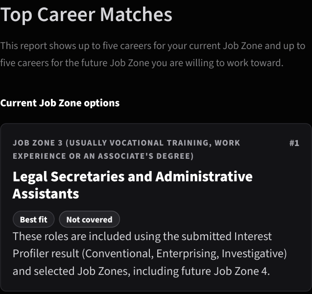
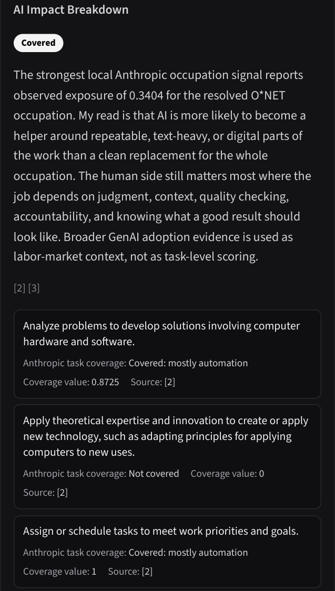
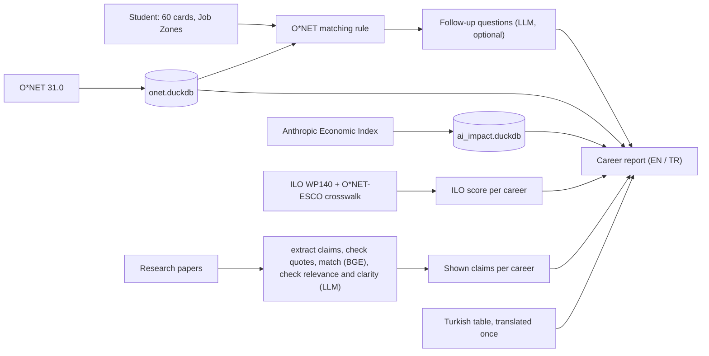

# AI-Aware Career Guide

A career test for university students, in Turkish and English: it suggests careers from your interests and shows, for each one, what the evidence says about AI and that job, including where there is no evidence.

<p>
  
  
</p>

*Left: a report's first match. "Not covered" means none of its tasks showed Claude use, which is not the same as safe from AI. Right: the task-by-task AI table of another career.*

Python 3.13 · Streamlit · DuckDB · O\*NET 31.0 · 57 tests · evaluation notebooks in [`notebooks/`](notebooks/)

## What it does

1. **The test.** 60 yes/no activity cards (O\*NET's Interest Profiler short form) give six interest scores. The student then picks their **department** (96 Turkish university departments). If it isn't listed, they pick a preparation level instead (O\*NET's Job Zones).
2. **The matches.** A department's careers come from the US fields of study it corresponds to, through NCES's official field-of-study → occupation crosswalk, reviewed by hand. They are ranked by **O\*NET's own matching rule** (Pearson r between the student's scores and each occupation's, "Best fit" r ≥ .729); without a department, the rule runs over every occupation in both Job Zones. Optional follow-up questions, interpreted by an LLM, refine the order.
3. **The report,** on its own results screen (wider on a desktop). Each career card shows what the job does, its most important tasks, skills and education, and **AI evidence from independent sources side by side, never merged into one score**:
   - **Anthropic task coverage:** which of the job's tasks people actually do with Claude (observed use, Aug and Nov 2025), and how much Claude is used for the job worldwide and in Turkey.
   - **The ILO's exposure index:** how exposed the job's broader occupation group is to generative AI, assessed by experts and a model.
   - **Research findings:** up to 3 claims from papers and reports about this career, each with its **verbatim quote**, page and source.
4. **New job titles,** at the end of the results. Titles O\*NET has no occupation for (prompt engineer, data annotator, MLOps engineer…) show their closest O\*NET roles, with a note that they are not the same job.

Real output, from the test profile `investigative_conventional` ([`baseline/`](baseline/)): its first matches for Job Zone 3 are *Computer Systems Engineers/Architects, Web Developers, Forensic Science Technicians, Chemical Technicians, Quality Control Analysts*, all "Best fit".

## Why it exists

Students choosing a career ask "will AI take this job?" The usual answers are a single risk score with unclear meaning, or nothing. This project asks a narrower question: **can AI-impact evidence be attached to individual careers honestly, and how much of it exists?**

The second half has a clear answer in the data. Of the 18,681 O\*NET tasks with an Anthropic value, **90.8% are not covered**, and **442 of 923 careers (48%) have no covered task at all**. 127 careers have no AI evidence in any source. So the most common thing the app says is "not observed", and it says what that means: no Claude use was seen, which is **not** the same as "safe from AI". Coverage follows preparation and kind of work: office, computer and teaching tasks are covered; construction, production and repair almost never are ([notebook 54](notebooks/54_ai_coverage.ipynb)).

## How it works



Facts are **looked up, not generated**: O\*NET details, task coverage and ILO scores come from exact lookups by O\*NET code and task, and research claims are shown with their quotes. The LLM writes only "a day in the life" and interprets follow-up answers. Without an API key, both fall back to templates and the report still builds.

## Data

| Source | Used for | Size | License |
| --- | --- | --- | --- |
| [O\*NET 31.0](https://www.onetcenter.org/database.html) | occupations, tasks, interests, Job Zones, skills | 923 careers with tasks, 18,838 tasks | CC BY 4.0 |
| [O\*NET Interest Profiler short form](https://www.onetcenter.org/IP.html) | the 60 cards and the matching rule | 60 activities | O\*NET |
| [Anthropic Economic Index](https://huggingface.co/datasets/Anthropic/EconomicIndex) | task coverage; Claude usage (global, Turkey) | release 2026-06-26 | CC BY |
| [ILO Working Paper 140](https://www.ilo.org/publications/generative-ai-and-jobs-refined-global-index-occupational-exposure) | exposure of 427 ISCO-08 groups, linked to 909 careers | 427 groups | CC BY 4.0 |
| Research papers and reports ([`source_urls.txt`](data/research/source_urls.txt)) | 3,283 claims, each quote checked against its source text; 402 shown across 740 careers | 47 sources, 42 with claims | quotes only; the papers are not in the repo |
| Turkish content ([`content_tr.csv`](data/i18n/content_tr.csv)) | O\*NET texts and claims in Turkish | 8,795 strings | an adaptation of O\*NET (CC BY 4.0) |

## Evaluation

Each number comes from a notebook that recomputes it ([`notebooks/`](notebooks/)).

| Question | Result | Notebook |
| --- | --- | --- |
| Do the matches agree with O\*NET's official Interest Profiler (API)? | **99.08%** of careers listed by both; fit labels agree for **99.86%** | [52](notebooks/52_matching_vs_onet.ipynb) |
| How much of O\*NET does Anthropic's evidence cover? | 9.2% of tasks covered; 48% of careers have no covered task | [54](notebooks/54_ai_coverage.ipynb) |
| Are the research claims a career shows about that career? | **71%** of the judged shown claims (53 of 75, 40 labelled careers); the LLM check agrees with the labels at κ = 0.69 | [53](notebooks/53_claims_retrieval.ipynb) |
| Are the extracted claims right? | claim text right for **80%** of a June sample and **62%** of the claims added in October; claim, impact type, direction and entity all right for only **40%** and **36%** | [42](notebooks/42_claim_label_audit.ipynb) |

What the weak numbers changed: the app shows **no impact type or direction labels**, only the claim, its quote and its source. Claims that don't stand on their own ("It is 9% for blue-collar…") are filtered out by a separate check, which raised the share of audited shown claims that are right from 9 of 14 to 7 of 8. The labels were drafted by an LLM (Claude) and accepted by me, so agreement with them is partly one model agreeing with another.

## Limitations

- **Anthropic coverage is observed Claude use**, from one provider, in two months of 2025, with users weighted toward the US. It shows where Claude is used, not what AI can or will do.
- **O\*NET describes US jobs.** The Turkish titles are translations, not Turkey's official occupation titles (that list is not openly available yet).
- **Research claims are extracted by an LLM** and only partly checked by hand; about 3 in 10 shown claims were judged not about the career. Quotes stay in English.
- **The follow-up reranking uses hand-set weights**, not tuned on data.
- **Each report with an API key costs money:** about 10 "day in the life" calls, plus the follow-ups.

## Keeping it current

- **On the 25th of each month,** a scheduled Claude routine searches for new studies and proposes them in a pull request ([`docs/SOURCE_SCOUT.md`](docs/SOURCE_SCOUT.md)).
- **On the 1st,** a GitHub Action ([`monthly_research_update.yml`](.github/workflows/monthly_research_update.yml)):
  - checks the data sources for new releases;
  - adds the merged sources' claims, paying only for what's new;
  - translates them and re-runs the notebooks;
  - opens a pull request.

## Setup

Python 3.13. From the project root:

```bash
python -m venv .venv
source .venv/bin/activate        # Windows: .venv\Scripts\activate
python -m pip install -r requirements.lock.txt
python scripts/build_all_artifacts.py   # downloads ~315 MB of public data and builds the databases
python -m streamlit run interest_profiler_app.py
```

- **Optional:** copy `.env.example` to `.env` and set `OPENAI_API_KEY` for the follow-up interpretation and "a day in the life". Turkish reports need no key.
- **Research pipeline and notebooks:** install `requirements-research.lock.txt` or `requirements-notebooks.lock.txt` instead.
- **Checks:** `python -m pytest` and `python scripts/make_baseline.py --check`.

## Repository

```text
interest_profiler_app.py   the Streamlit app
career_rag/                the app's modules and styles
scripts/                   building the data, the research pipeline, checks (see scripts/README.md)
notebooks/                 the evaluations
data/                      committed tables (Turkish content, shown claims, ILO scores, new titles); the rest is built
baseline/                  reports of three test profiles, compared after every change
tests/                     unit tests
docs/                      ROADMAP, CHANGELOG (every change, with its mistakes), DECISIONS, DATA_SOURCES
```

Every change is recorded in [`docs/CHANGELOG.md`](docs/CHANGELOG.md): what was wrong, what changed, and how it was checked.

## References

- O\*NET Interest Profiler matching rule: Gregory & Lewis (2016), [*Linking Client Assessment Profiles to O\*NET Occupational Profiles*](https://www.onetcenter.org/dl_files/Mini-IP_Linking.pdf)
- [O\*NET Interest Profiler Short Form psychometric report](https://www.onetcenter.org/reports/IPSF_Psychometric.html)
- Anthropic, [Labor market impacts of AI](https://www.anthropic.com/research/labor-market-impacts) and the [Economic Index](https://www.anthropic.com/economic-index)
- Gmyrek et al. (2025), [Generative AI and jobs: a refined global index of occupational exposure](https://www.ilo.org/publications/generative-ai-and-jobs-refined-global-index-occupational-exposure), ILO Working Paper 140
- Renji et al. (2025), [Steve: LLM Powered ChatBot for Career Progression](https://arxiv.org/abs/2504.03789)
- Jeon et al. (2025), [Letters from Future Self](https://arxiv.org/abs/2502.18881)

**O\*NET attribution:** this project includes information from the O\*NET 31.0 Database by the U.S. Department of Labor, Employment and Training Administration (USDOL/ETA), used under the CC BY 4.0 license. O\*NET® is a trademark of USDOL/ETA. The information was modified (selected, combined with other sources, and translated into Turkish); USDOL/ETA has not approved, endorsed, or tested these modifications.
